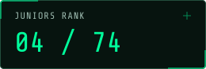
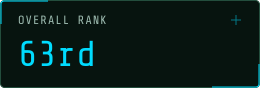
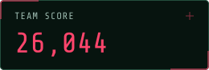
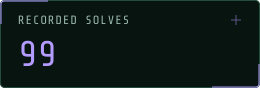

<p align="center">
  
</p>

```text
██╗  ██╗██████╗ ███████╗███████╗ ██████╗████████╗███████╗
╚██╗██╔╝██╔══██╗██╔════╝██╔════╝██╔════╝╚══██╔══╝██╔════╝
 ╚███╔╝ ██████╔╝█████╗  █████╗  ██║        ██║   █████╗  
 ██╔██╗ ██╔══██╗██╔══╝  ██╔══╝  ██║        ██║   ██╔══╝  
██╔╝ ██╗██║  ██║███████╗██║     ╚██████╗   ██║   ██║     
╚═╝  ╚═╝╚═╝  ╚═╝╚══════╝╚═╝      ╚═════╝   ╚═╝   ╚═╝     
```

# `XREFctf // RESULTS & DOSSIER`


## `[ 0x01 : OPERATION CSCTF_2026 ]`

```diff
+ MISSION BRIEF: We competed in CSCTF 2026 as XREFctf, an independent team from Egypt.
+ DIVISION: Juniors — 4th out of 74 teams.
! INTEL NOTE: Results reflect the frozen scoreboard viewed on 9 November 2026.
```

| JUNIORS RANK | OVERALL RANK | TEAM SCORE | RECORDED SOLVES |
|:---:|:---:|:---:|:---:|
|  |  |  |  |

## `[ 0x02 : ACTIVE OPERATORS ROSTER ]`

> `root@xrefctf:~# cat /etc/operators_manifest.conf`

Scores include platform awards and hint adjustments. The bars show each account’s share of the displayed team score.

| Operator | Role | Score | Solves | Score Share |
|---|---|---:|---:|---|
| [`0xmhmdnsar`](https://2026.chronos-security.ro/users/1672) | `Member` | `8,038` | `32` | `██████░░░░░░░░░░░░░░` `30.9%` |
| [`Samurai-16`](https://2026.chronos-security.ro/users/1160) | `Captain` | `6,478` | `26` | `█████░░░░░░░░░░░░░░░` `24.9%` |
| [`dark wing`](https://2026.chronos-security.ro/users/1567) | `Member` | `5,808` | `24` | `████░░░░░░░░░░░░░░░░` `22.3%` |
| [`Gedo0x`](https://2026.chronos-security.ro/users/1319) | `Member` | `4,028` | `11` | `███░░░░░░░░░░░░░░░░░` `15.5%` |
| [`cracker`](https://2026.chronos-security.ro/users/1180) | `Member` | `1,692` | `6` | `█░░░░░░░░░░░░░░░░░░░` `6.5%` |

## `[ 0x03 : RECORDED SOLVES LOG ]`

```yaml
Source: CSCTF 2026 solve history
Submitted_By: Account credited with the accepted submission
Teamwork: Other members may have helped with the solution
```

<details>
<summary><strong>[ + ] EXPAND LOG // 99 RECORDED SOLVES</strong></summary>

| Mission | Category | Submitted by | Points | Writeup |
|---|---|---|---:|---|
| Countersign | `Crypto` | `0xmhmdnsar` | `120` | [READ](CTF-Writeups/crypto/Countersign.md) |
| Emanation | `Crypto` | `0xmhmdnsar` | `270` | [READ](CTF-Writeups/crypto/Emanation.md) |
| Operation Dawn: The Courier's Keys | `Crypto` | `0xmhmdnsar` | `270` | [READ](CTF-Writeups/crypto/Operation_Dawn_The_Couriers_Keys.md) |
| Rollback Pair | `Crypto` | `0xmhmdnsar` | `120` | [READ](CTF-Writeups/crypto/Rollback_Pair.md) |
| Signing Authority | `Crypto` | `0xmhmdnsar` | `120` | [READ](CTF-Writeups/crypto/Signing_Authority.md) |
| The Key Wheel | `Crypto` | `0xmhmdnsar` | `120` | [READ](CTF-Writeups/crypto/The_Key_Wheel.md) |
| The Signet | `Crypto` | `0xmhmdnsar` | `120` | [READ](CTF-Writeups/crypto/The_Signet.md) |
| Watchword | `Crypto` | `0xmhmdnsar` | `270` | [READ](CTF-Writeups/crypto/Watchword.md) |
| Afterimage | `Forensics` | `dark wing` | `270` | [READ](CTF-Writeups/forensics/Afterimage.md) |
| Briefing for One | `Forensics` | `0xmhmdnsar` | `270` | [READ](CTF-Writeups/forensics/Briefing_for_One.md) |
| CAPTCHA the Water Plant | `Forensics` | `dark wing` | `120` | [READ](CTF-Writeups/forensics/CAPTCHA_the_Water_Plant.md) |
| Code Red Freight | `Forensics` | `0xmhmdnsar` | `270` | [READ](CTF-Writeups/forensics/Code_Red_Freight.md) |
| Dawn Array | `Forensics` | `dark wing` | `270` | [READ](CTF-Writeups/forensics/Dawn_Array.md) |
| Flotsam | `Forensics` | `0xmhmdnsar` | `120` | [READ](CTF-Writeups/forensics/Flotsam.md) |
| Ghost in the Historian | `Forensics` | `0xmhmdnsar` | `270` | [READ](CTF-Writeups/forensics/Ghost_in_the_Historian.md) |
| Interlock Witness | `Forensics` | `dark wing` | `270` | [READ](CTF-Writeups/forensics/Interlock_Witness.md) |
| Last Buffer | `Forensics` | `dark wing` | `120` | [READ](CTF-Writeups/forensics/Last_Buffer.md) |
| Last Commit | `Forensics` | `Samurai-16` | `270` | — |
| Night Clerk | `Forensics` | `Samurai-16` | `120` | — |
| Operation Dawn: Relay Snapshot | `Forensics` | `Samurai-16` | `120` | — |
| Operation Dawn: The Burnt Server | `Forensics` | `Samurai-16` | `120` | — |
| Operation Dawn: The Medic's Phone | `Forensics` | `dark wing` | `270` | [READ](CTF-Writeups/forensics/Operation_Dawn_The_Medics_Phone.md) |
| Operation Dawn: The Relay Tap | `Forensics` | `Samurai-16` | `120` | — |
| Phantom Drift | `Forensics` | `dark wing` | `560` | [READ](CTF-Writeups/forensics/Phantom_Drift.md) |
| Polyglot Requiem | `Forensics` | `dark wing` | `270` | [READ](CTF-Writeups/forensics/Polyglot_Requiem.md) |
| Redline | `Forensics` | `dark wing` | `120` | [READ](CTF-Writeups/forensics/Redline.md) |
| Shadow-Dispatch | `Forensics` | `dark wing` | `592` | [READ](CTF-Writeups/forensics/Shadow-Dispatch.md) |
| Signal Reconciliation | `Forensics` | `dark wing` | `120` | [READ](CTF-Writeups/forensics/Signal_Reconciliation.md) |
| Silent Breaker | `Forensics` | `dark wing` | `270` | [READ](CTF-Writeups/forensics/Silent_Breaker.md) |
| The Capability Ghost | `Forensics` | `dark wing` | `120` | [READ](CTF-Writeups/forensics/The_Capability_Ghost.md) |
| The Layer That Wouldn't Die | `Forensics` | `0xmhmdnsar` | `120` | [READ](CTF-Writeups/forensics/The_Layer_That_Wouldnt_Die.md) |
| Tone Burst | `Forensics` | `dark wing` | `120` | [READ](CTF-Writeups/forensics/Tone_Burst.md) |
| Operation Blackout | `ICS` | `0xmhmdnsar` | `540` | [READ](CTF-Writeups/ics/Operation_Blackout.md) |
| Command Calendar Reconciliation | `Misc` | `0xmhmdnsar` | `120` | [READ](CTF-Writeups/misc/Command_Calendar_Reconciliation.md) |
| golem | `Misc` | `0xmhmdnsar` | `120` | [READ](CTF-Writeups/misc/golem.md) |
| lattice | `Misc` | `0xmhmdnsar` | `120` | [READ](CTF-Writeups/misc/lattice.md) |
| Operation Dawn: The Cipher Lock | `Misc` | `Samurai-16` | `540` | — |
| Operation Dawn: The Reconnaissance Plate | `Misc` | `dark wing` | `120` | [READ](CTF-Writeups/misc/Operation_Dawn_The_Reconnaissance_Plate.md) |
| Operation Dawn: The Shared Model | `Misc` | `Samurai-16` | `120` | — |
| Operation Dawn: Watch List Audit | `Misc` | `Samurai-16` | `120` | — |
| Telltale | `Misc` | `dark wing` | `120` | [READ](CTF-Writeups/misc/Telltale.md) |
| warden | `Misc` | `Samurai-16` | `282` | — |
| Operation Dawn: The Sentry's Model | `ML` | `0xmhmdnsar` | `540` | [READ](CTF-Writeups/ml/Operation_Dawn_The_Sentrys_Model.md) |
| VaultKeeper | `Mobile` | `cracker` | `120` | — |
| Dark Anchorage Reconciliation | `Network` | `dark wing` | `270` | [READ](CTF-Writeups/network/Dark_Anchorage_Reconciliation.md) |
| Ghost Signal | `Network` | `0xmhmdnsar` | `540` | [READ](CTF-Writeups/network/Ghost_Signal.md) |
| grid-watch | `Network` | `0xmhmdnsar` | `540` | [READ](CTF-Writeups/network/grid-watch.md) |
| Hard Landing | `Network` | `Gedo0x` | `120` | [READ](CTF-Writeups/network/Hard_Landing.md) |
| Radar Silence | `Network` | `cracker` | `120` | — |
| Severed Link | `Network` | `0xmhmdnsar` | `120` | [READ](CTF-Writeups/network/Severed_Link.md) |
| Silent Orbit | `Network` | `0xmhmdnsar` | `120` | [READ](CTF-Writeups/network/Silent_Orbit.md) |
| Water Hammer Reconciliation | `Network` | `Samurai-16` | `270` | — |
| Cloudflare Deanon: Find the Back Office | `OSINT` | `cracker` | `327` | — |
| Cloudflare Deanon: Find the Origin | `OSINT` | `cracker` | `320` | — |
| Cloudflare Deanon: Read the Platform | `OSINT` | `dark wing` | `120` | [READ](CTF-Writeups/osint/Cloudflare_Deanon_Read_the_Platform.md) |
| Harvest | `OSINT` | `cracker` | `270` | — |
| Onion Deanon 1: Fingerprint the Certificate | `OSINT` | `0xmhmdnsar` | `120` | [READ](CTF-Writeups/osint/Onion_Deanon_1_Fingerprint_the_Certificate.md) |
| Onion Deanon 1: Read the Certificate | `OSINT` | `Samurai-16` | `120` | — |
| Onion Deanon 2: Hash the Favicon Again | `OSINT` | `0xmhmdnsar` | `0` | [READ](CTF-Writeups/osint/Onion_Deanon_2_Hash_the_Favicon_Again.md) |
| Onion Deanon 2: Read the Favicon | `OSINT` | `0xmhmdnsar` | `120` | — |
| echo_chamber | `Pwn` | `dark wing` | `540` | [READ](CTF-Writeups/pwn/echo_chamber.md) |
| forge | `Pwn` | `Samurai-16` | `270` | — |
| relic | `Pwn` | `Samurai-16` | `270` | — |
| sigil | `Pwn` | `0xmhmdnsar` | `540` | [READ](CTF-Writeups/pwn/sigil.md) |
| stepper | `Pwn` | `Samurai-16` | `609` | — |
| Carrier Shadow | `Reverse Engineering` | `Samurai-16` | `540` | [READ](CTF-Writeups/reverse_engineering/Carrier_Shadow.md) |
| Command Authority | `Reverse Engineering` | `Samurai-16` | `120` | — |
| Fence Shift | `Reverse Engineering` | `Samurai-16` | `270` | — |
| Ghost Bank | `Reverse Engineering` | `Samurai-16` | `546` | — |
| Ground Lock | `Reverse Engineering` | `Samurai-16` | `120` | — |
| HELIOS-RTU | `Reverse Engineering` | `0xmhmdnsar` | `540` | — |
| Operation Dawn: Radio Recovery | `Reverse Engineering` | `Samurai-16` | `120` | — |
| PoshTerm | `Reverse Engineering` | `Samurai-16` | `120` | — |
| proprietary | `Reverse Engineering` | `Samurai-16` | `711` | — |
| Split Horizon | `Reverse Engineering` | `Samurai-16` | `270` | — |
| The Lock Box | `Reverse Engineering` | `Samurai-16` | `120` | — |
| Uplink Denied | `Reverse Engineering` | `Samurai-16` | `120` | — |
| Apogee | `Web` | `cracker` | `540` | — |
| Broadsheet Organizer | `Web` | `Gedo0x` | `851` | [READ](CTF-Writeups/web/Broadsheet_Organizer.md) |
| Corridor Transit Gate | `Web` | `0xmhmdnsar` | `299` | [READ](CTF-Writeups/web/Corridor_Transit_Gate.md) |
| Cutover | `Web` | `dark wing` | `540` | [READ](CTF-Writeups/web/Cutover.md) |
| Cyberboy | `Web` | `0xmhmdnsar` | `540` | [READ](CTF-Writeups/web/Cyberboy.md) |
| Helioform Relay | `Web` | `Gedo0x` | `682` | [READ](CTF-Writeups/web/Helioform_Relay.md) |
| Inside the Cordon | `Web` | `0xmhmdnsar` | `270` | [READ](CTF-Writeups/web/Inside_the_Cordon.md) |
| Interdiction Hold | `Web` | `Gedo0x` | `120` | [READ](CTF-Writeups/web/Interdiction_Hold.md) |
| Interlock | `Web` | `Gedo0x` | `593` | [READ](CTF-Writeups/web/Interlock.md) |
| Key Custody | `Web` | `dark wing` | `120` | [READ](CTF-Writeups/web/Key_Custody.md) |
| keyring | `Web` | `0xmhmdnsar` | `120` | [READ](CTF-Writeups/web/keyring.md) |
| Landfall | `Web` | `Gedo0x` | `741` | [READ](CTF-Writeups/web/Landfall.md) |
| Operation Dawn: The Access Log | `Web` | `dark wing` | `120` | [READ](CTF-Writeups/web/Operation_Dawn_The_Access_Log.md) |
| Operation Dawn: The Command Seal | `Web` | `Gedo0x` | `270` | [READ](CTF-Writeups/web/Operation_Dawn_The_Command_Seal.md) |
| Operation Dawn: The Dispatch Console | `Web` | `dark wing` | `271` | [READ](CTF-Writeups/web/Operation_Dawn_The_Dispatch_Console.md) |
| Operation Dawn: The Standing Order | `Web` | `0xmhmdnsar` | `289` | [READ](CTF-Writeups/web/Operation_Dawn_The_Standing_Order.md) |
| smuggler | `Web` | `Gedo0x` | `120` | [READ](CTF-Writeups/web/smuggler.md) |
| switchboard | `Web` | `Gedo0x` | `120` | [READ](CTF-Writeups/web/switchboard.md) |
| Two-Key Turn | `Web` | `Gedo0x` | `120` | [READ](CTF-Writeups/web/Two-Key_Turn.md) |
| Vesper Quay Board | `Web` | `Gedo0x` | `291` | [READ](CTF-Writeups/web/Vesper_Quay_Board.md) |
| Comms Check | `Welcome` | `dark wing` | `100` | [READ](CTF-Writeups/welcome/Comms_Check.md) |
| Welcome Aboard | `Welcome` | `Samurai-16` | `100` | — |

`SCORE LEDGER` — 26,104 challenge points, -60 net hint adjustments, 26,044 displayed team points.

Writeup links open populated files in the repository. Empty templates have no link.

</details>

## `[ 0x04 : SELECTED TEAM RESULTS // ARCHIVE ]`

> `root@xrefctf:~# ./fetch_ctftime_history.sh`

| Event | Placement | Record |
|---|---|---|
| [CAT CTF 26](https://ctftime.org/event/3360) | `3rd Place` | `TOP 3 // CTFTIME` |
| [BYUCTF 2026](https://ctftime.org/event/3247) | `44th Place` | `CTFTIME` |
| CyCTF 2026 | `55th Place` | `TEAM RECORD` |
| [0xV01D CTF 2026](https://ctftime.org/event/3269) | `64th Place` | `CTFTIME` |

CyCTF 2026 comes from our team record. The other placements link to CTFtime results.

[XREFctf on CTFtime](https://ctftime.org/team/427933) — team rosters may differ between events.

## `[ 0x05 : INTEL SOURCES & VERIFICATION ]`

- [Juniors scoreboard // 4th of 74](https://2026.chronos-security.ro/scoreboard?bracket=1)
- [Overall scoreboard // 63rd](https://2026.chronos-security.ro/scoreboard)
- [CSCTF team profile // XREFctf](https://2026.chronos-security.ro/teams/91415)

```text
================================================================================
        [ XREFctf · EGYPT · CSCTF 2026 / JUNIORS DIVISION // EOF ]
================================================================================
```
